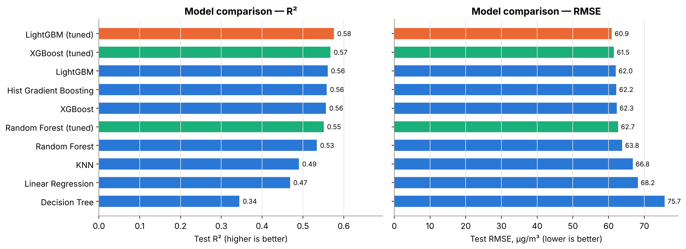
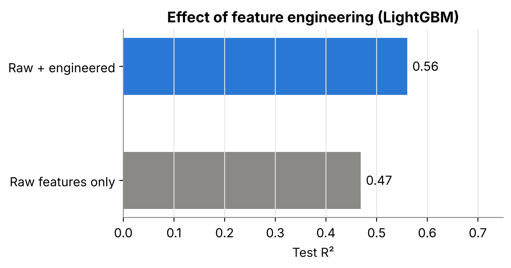
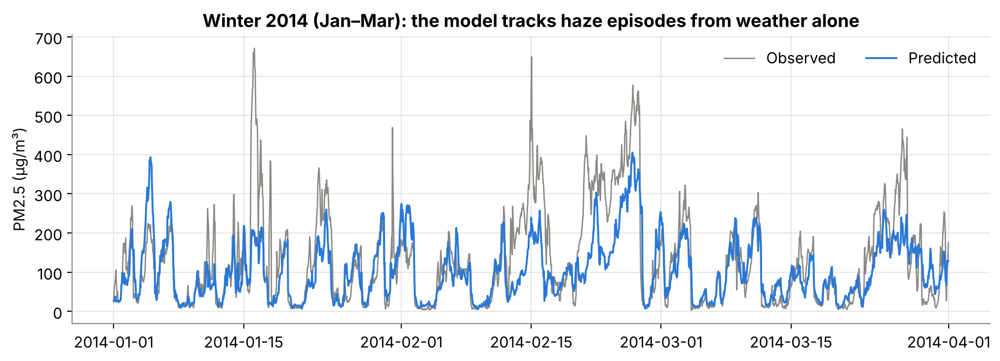
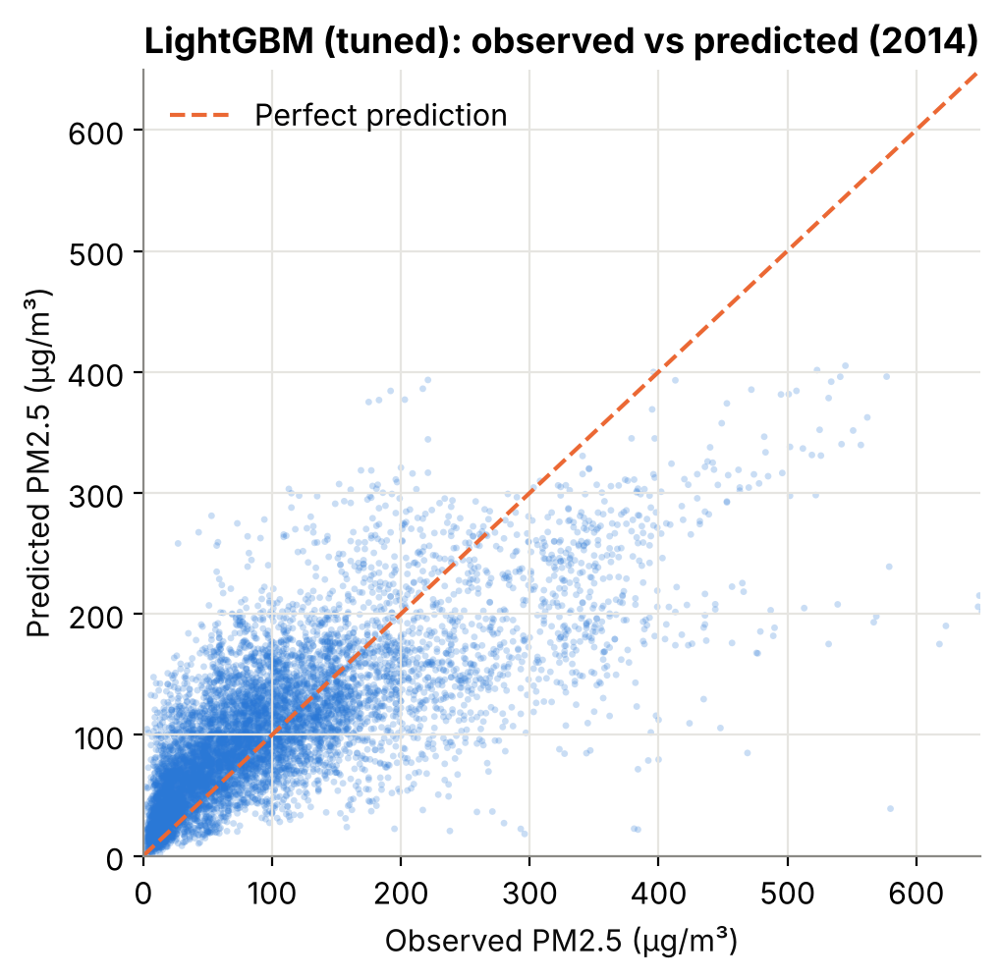
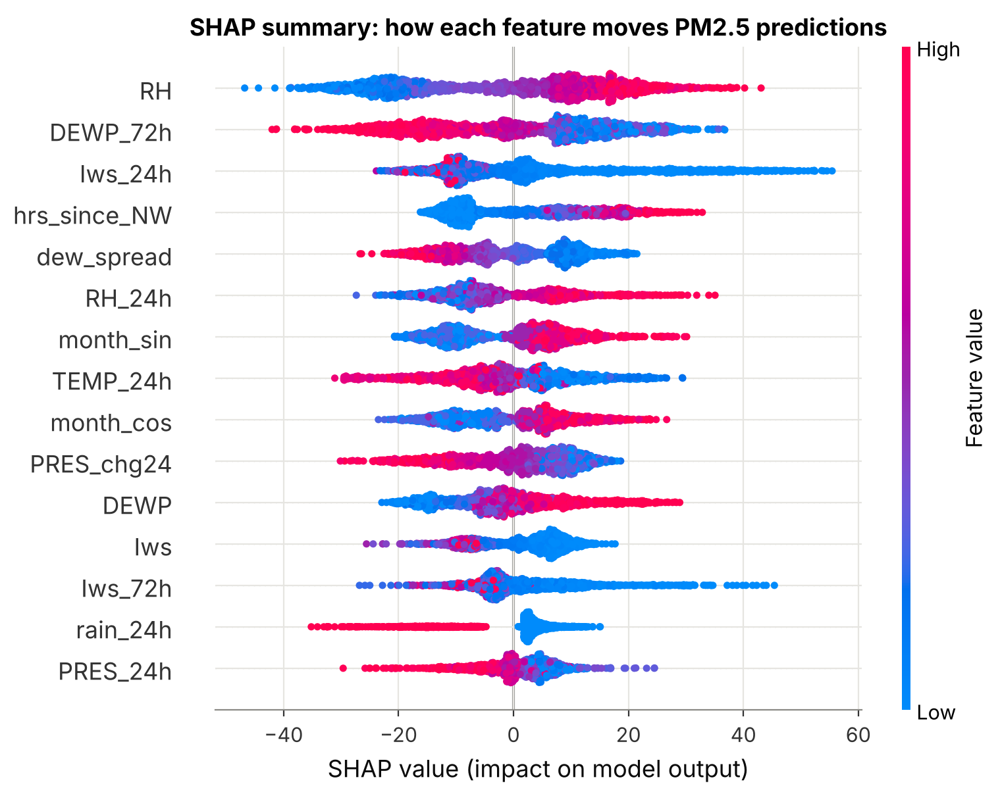
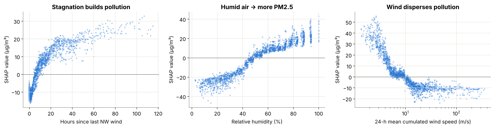

# Predicting Beijing PM2.5 Air Pollution from Weather with Machine Learning

**Course:** 2107541 — Project 2: Environmental Machine Learning Project
**Group member:** Warakorn Jaiwang (6730467221)



**Source code:** [`notebooks/ML_analysis.ipynb`](notebooks/ML_analysis.ipynb) (step-by-step notebook with outputs) ·
[`src/ML_analysis.py`](src/ML_analysis.py) (same code as a plain Python script) ·
[](https://colab.research.google.com/github/6730467221/Environmental-ML-Project/blob/main/notebooks/ML_analysis.ipynb)

---

## 1. Environmental Problem

Fine particulate matter (**PM2.5**, particles ≤ 2.5 µm) penetrates deep into the lungs and bloodstream and is linked to
respiratory disease, heart disease and premature death. Large Asian cities — Beijing, and in Thailand Bangkok and Chiang Mai —
regularly experience severe haze episodes, especially in winter and the dry season.

Emissions (traffic, industry, coal heating, biomass burning) produce the pollution, but **weather decides whether it
disperses or accumulates**. Understanding which meteorological conditions lead to high PM2.5 helps cities forecast haze
episodes and act before they happen.

In this dataset, **77% of days exceeded Thailand's 24-hour PM2.5 standard (37.5 µg/m³)** and the mean concentration was
98.6 µg/m³ — about 6.5× the WHO 24-hour guideline (15 µg/m³).

## 2. Dataset Source

**Beijing PM2.5 Data** — hourly PM2.5 at the US Embassy in Beijing + meteorological data from Beijing Capital
International Airport, **1 Jan 2010 – 31 Dec 2014, 43,824 hourly records, 13 columns**.

- Original: UCI Machine Learning Repository — Chen, S. (2015). *Beijing PM2.5* [Dataset]. https://doi.org/10.24432/C5JS49
- Kaggle mirror: https://www.kaggle.com/datasets/rupakroy/lstm-datasets-multivariate-univariate
- Paper: Liang, X. et al. (2015). Assessing Beijing's PM2.5 pollution: severity, weather impact, APEC and winter heating. *Proc. R. Soc. A*, 471: 20150257.
- File in this repo: [`data/beijing_pm25.csv`](data/beijing_pm25.csv)

| Column | Description |
|---|---|
| `year, month, day, hour` | Timestamp |
| `pm2.5` | PM2.5 concentration (µg/m³) — **target** |
| `DEWP` | Dew point (°C) |
| `TEMP` | Temperature (°C) |
| `PRES` | Pressure (hPa) |
| `cbwd` | Combined wind direction (NE, NW, SE, cv = calm/variable) |
| `Iws` | Cumulated wind speed (m/s) |
| `Is` / `Ir` | Cumulated hours of snow / rain |

## 3. Research Questions

1. How accurately can meteorological conditions predict hourly PM2.5 concentration?
2. Which machine learning model performs best for this task?
3. Which weather factors most strongly control PM2.5 levels, and how?

## 4. Methods

| Step | What we did |
|---|---|
| **Problem definition** | Supervised **regression**: predict hourly PM2.5 (µg/m³) from weather + time features only (no past PM2.5 → the model must learn weather → pollution). |
| **Train/test split** | **Time-based**: train 2010–2013 (33,096 h), test **2014** (8,661 h, never seen in training or tuning). |
| **Preprocessing** | Datetime index; rows with missing PM2.5 (4.7%) removed (not imputed); one-hot wind direction; sin/cos encoding of hour & month; standard scaling for Linear Regression & KNN. |
| **Feature engineering** | 12 physically based features describing humidity and atmospheric stagnation: relative humidity (Magnus formula), dew-point spread, 24 h / 72 h rolling means of dew point, wind and pressure, 24 h pressure change, **hours since last NW wind**, rain in last 24 h. Total 27 features. |
| **Models (7)** | Linear Regression, K-Nearest Neighbours, Decision Tree, Random Forest, Histogram Gradient Boosting, XGBoost, LightGBM. |
| **Hyperparameter tuning** | `RandomizedSearchCV` with `TimeSeriesSplit` (3 folds) on the training years for Random Forest, XGBoost, LightGBM. |
| **Evaluation** | R², RMSE, MAE on the 2014 test year; observed-vs-predicted and time-series plots; hit rate for unhealthy hours (> 75 µg/m³). |
| **Explainable ML** | Permutation importance and **SHAP** (TreeExplainer) summary, ranking and dependence plots. |

### Notebook steps

| Step | Content | Step | Content |
|---|---|---|---|
| 1 | Import libraries (pandas, scikit-learn, XGBoost, LightGBM, SHAP) | 11 | Histogram Gradient Boosting |
| 2 | Import the dataset | 12 | XGBoost Regression |
| 3 | Explore the dataset (EDA + 4 figures) | 13 | LightGBM Regression |
| 4 | Data preprocessing | 14 | Compare the 7 models |
| 5 | Feature engineering | 15 | Effect of feature engineering |
| 6 | Train/test split (time-based) | 16 | Hyperparameter tuning (RF, XGBoost, LightGBM) |
| 7 | Linear Regression (baseline) | 17 | Model evaluation + figures |
| 8 | K-Nearest Neighbours | 18 | Feature importance: permutation + SHAP |
| 9 | Decision Tree | 19 | Environmental interpretation |
| 10 | Random Forest | | |

Example of the model code (Step 10):

```python
from sklearn.ensemble import RandomForestRegressor
from sklearn.metrics import r2_score, mean_absolute_error, mean_squared_error

rf_model = RandomForestRegressor(n_estimators=200, n_jobs=-1, random_state=42)
rf_model.fit(X_train, y_train)
y_pred_rf = rf_model.predict(X_test)

print("R²:", r2_score(y_test, y_pred_rf))
print("MAE:", mean_absolute_error(y_test, y_pred_rf))
print("RMSE:", np.sqrt(mean_squared_error(y_test, y_pred_rf)))
```

## 5. Main Results

Test set = year 2014 (unseen).

| Model | R² | RMSE (µg/m³) | MAE (µg/m³) |
|---|---|---|---|
| **LightGBM (tuned)** | **0.576** | **60.9** | **41.3** |
| XGBoost (tuned) | 0.567 | 61.5 | 41.8 |
| LightGBM | 0.561 | 62.0 | 41.8 |
| Hist Gradient Boosting | 0.558 | 62.2 | 42.1 |
| XGBoost | 0.557 | 62.3 | 42.3 |
| Random Forest (tuned) | 0.551 | 62.7 | 43.2 |
| Random Forest | 0.534 | 63.8 | 44.6 |
| KNN | 0.490 | 66.8 | 46.6 |
| Linear Regression | 0.468 | 68.2 | 47.5 |
| Decision Tree | 0.344 | 75.7 | 51.5 |

**Feature engineering effect (LightGBM):** raw features only R² = 0.469 → raw + engineered R² = 0.561 (+9 points).




## 6. Best Model

**Tuned LightGBM** — `num_leaves=63, learning_rate=0.02, n_estimators=500, colsample_bytree=0.6, subsample=0.85, reg_lambda=1`.

- Explains **~58% of hourly PM2.5 variance** in an unseen year using weather alone.
- As a warning tool for unhealthy hours (PM2.5 > 75 µg/m³) it catches **~91%** of them (recall) with ~73% precision.
- Boosting models win because the weather–pollution relationship is strongly non-linear with interactions
  (e.g. calm + humid + winter); linear regression cannot capture this.



## 7. Feature Importance (Explainable ML)

Top drivers by mean |SHAP| (µg/m³): **RH (15.7)**, DEWP_72h (13.6), Iws_24h (11.7), hrs_since_NW (10.4), dew_spread (8.9).




## 8. Environmental Interpretation

1. **Humidity is the #1 driver.** High relative humidity raises PM2.5: moist air promotes secondary aerosol formation
   (sulfate, nitrate from SO₂/NOx) and hygroscopic particle growth, and humid southerly air masses carry regional
   pollution. Dry air (large dew-point spread) means cleaner air.
2. **Stagnation builds pollution.** The longer since the last north-westerly wind and the weaker the accumulated wind
   over 24 h, the higher PM2.5 — SHAP rises steeply during the first ~24–36 hours of stagnation. Pollution is not
   removed; it accumulates day after day.
3. **Natural cleaning mechanisms:** rain (wet deposition / washout) and rising pressure (arrival of a cold front) lower PM2.5.
4. **Wind direction:** NW winds bring clean, dry air from Mongolia (mean ≈ 70 µg/m³); SE winds (≈ 111 µg/m³) and calm
   conditions (≈ 126 µg/m³) bring or trap polluted air from the industrial North China Plain.
5. **Season and time of day:** winter (coal heating + temperature inversions) and night-time (shallow boundary layer)
   are the worst periods.

**Implications:** weather-based ML can give **early warning of haze episodes** from weather forecasts, so authorities
can issue health advisories or apply temporary emission controls (traffic, industry, open burning) *before* a stagnant,
humid period. The same workflow can be applied to Thai cities, where dry-season stagnation and biomass burning drive PM2.5.

**Limitations:** no emission or fire data, no past PM2.5 as input, a single monitoring station; the remaining ~42% of
unexplained variance reflects emissions and regional transport not captured by local weather.

## Repository Structure

```
Environmental-ML-Project/
├── README.md
├── data/
│   └── beijing_pm25.csv          # raw dataset (UCI / Kaggle)
├── notebooks/
│   └── ML_analysis.ipynb         # full workflow: EDA → models → tuning → SHAP
├── src/
│   └── ML_analysis.py            # same code as a plain Python script
├── figures/                      # all figures + model_results.csv generated by the notebook
└── requirements.txt
```

## How to Run

```bash
git clone https://github.com/6730467221/Environmental-ML-Project.git
cd Environmental-ML-Project
pip install -r requirements.txt
cd notebooks
jupyter notebook ML_analysis.ipynb     # Run All (~5 minutes on a laptop)

# or run the plain script
cd ../src && python ML_analysis.py
```

Or click **Open in Colab** above: the notebook downloads the data from this repository automatically.
